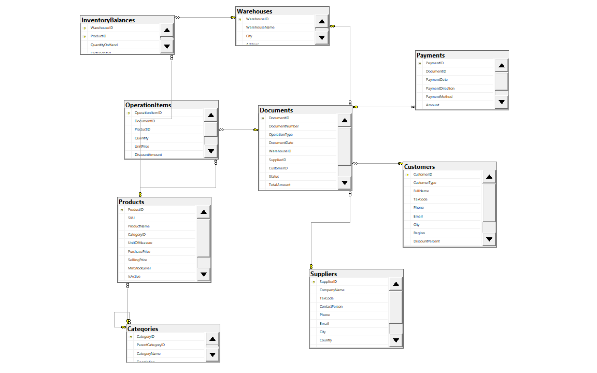

# Курсова робота з дисципліни «Надвеликі бази даних»

**Тема:** Розробка та аналіз надвеликої бази даних з використанням технологій Microsoft SQL Server  
**Варіант:** 8 — «Облік товарів» (порядковий номер у списку групи — 19)  
**Виконав:** Руденко Володимир Денисович, група АМ-43  

## Опис предметної області
Інформаційна система призначена для складського та управлінського обліку товарів, реєстрації прихідних, видаткових операцій та актів списання, контролю залишків по складах і взаєморозрахунків із постачальниками та покупцями.

## Структура репозиторію
- `Database/` — T-SQL скрипти розгортання OLTP-бази `InventoryManagement_OLTP` (таблиці в 3НФ, обмеження цілісності, індекси, тригери, збережені процедури та функції).
- `DataGeneration/` — скрипти генерації тестових даних (50 000+ товарів, 1 000 000+ операцій за 5 років).
- `SSIS_Projects/` — ETL-пакети завантаження даних у сховище Data Warehouse.
- `SSAS_Projects/` — багатовимірний OLAP-куб та MDX-обчислення.
- `SSRS_Projects/` — аналітичні звіти та дашборди.
- `Documentation/` — ER-діаграми та пояснювальна записка.

## Схема бази даних (OLTP)

## Інструкція із розгортання БД
Виконати скрипти в SQL Server Management Studio (SSMS) у такій послідовності:
1. `Database/CREATE_DATABASE.sql`
2. `Database/CREATE_TABLES.sql`
3. `Database/CREATE_CONSTRAINTS.sql`
4. `Database/CREATE_TRIGGERS.sql`
5. `Database/CREATE_PROCEDURES.sql`