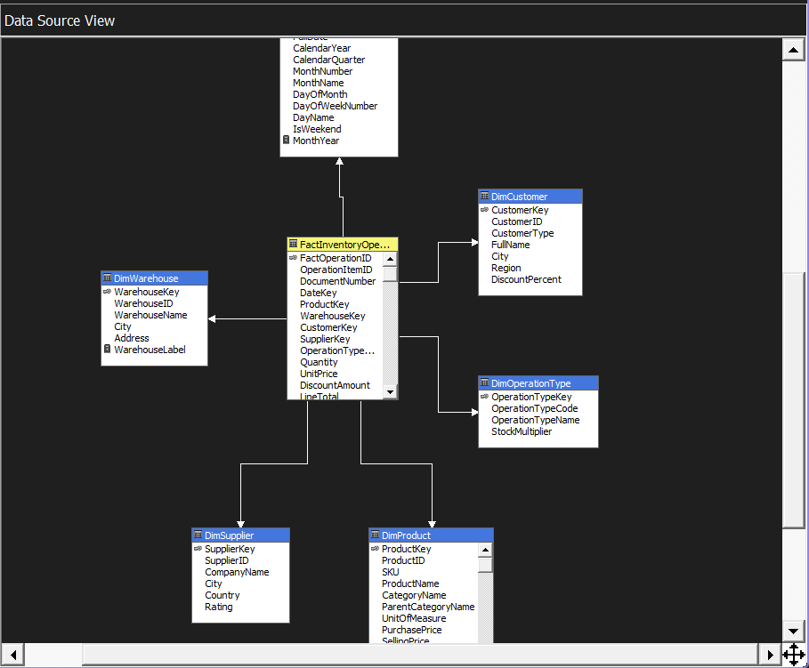
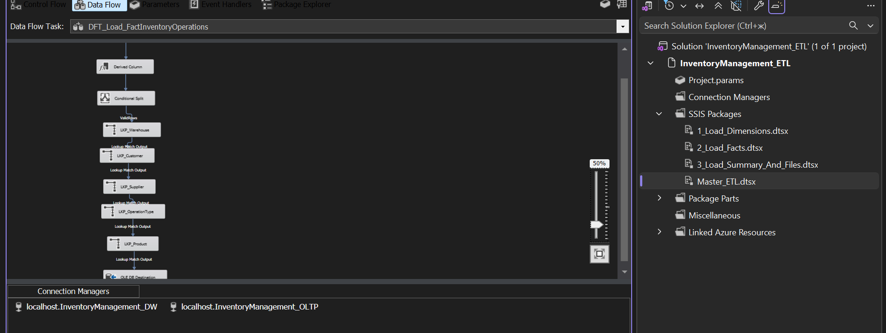
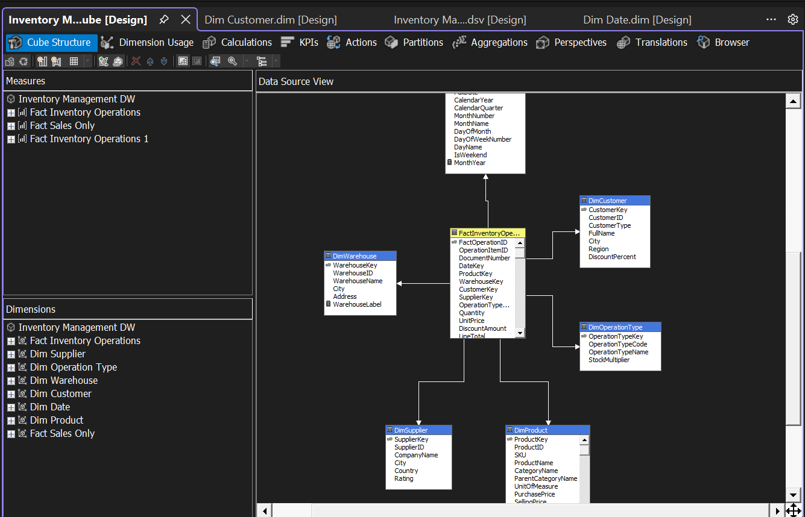
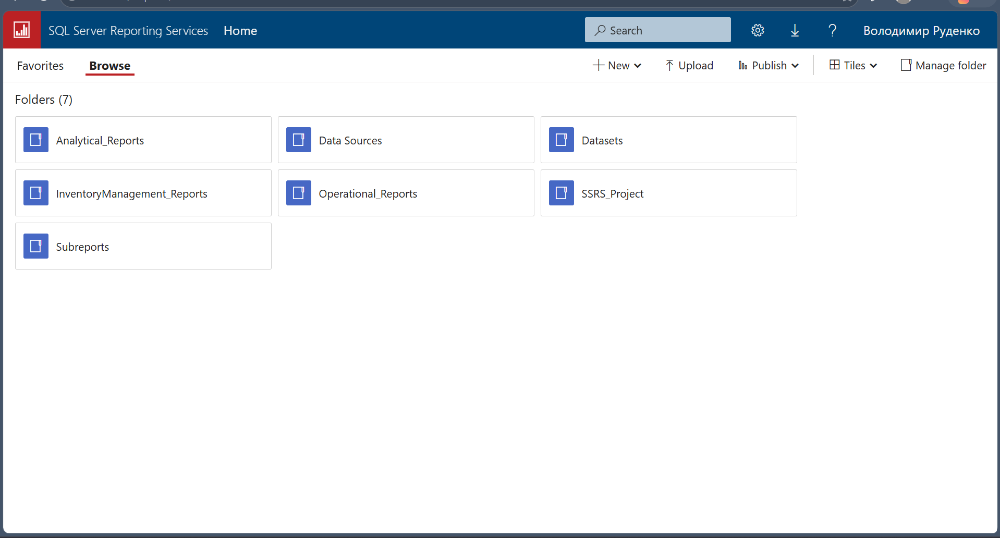

# Курсова робота з дисципліни «Надвеликі бази даних»

**Тема:** Розробка та аналіз надвеликої бази даних з використанням технологій Microsoft SQL Server  
**Варіант:** 8 — «Облік товарів» (порядковий номер у списку групи — 19)  
**Виконав:** Руденко Володимир Денисович, група АМ-43  
**Технологічний стек:** Microsoft SQL Server (T-SQL), SQL Server Integration Services (SSIS), SQL Server Analysis Services (SSAS), SQL Server Reporting Services (SSRS)

---

## Опис предметної області та масштабу даних
Інформаційна система призначена для автоматизації складського та управлінського обліку товарів, реєстрації прихідних, видаткових операцій та актів списання, контролю залишків по складах, проведення ABC-аналізу асортименту та обліку взаєморозрахунків із постачальниками й покупцями.

Обсяги згенерованих та оброблених даних (горизонт історії — **5 років**):
- **Довідник товарів:** понад 50 000 номенклатурних позицій;
- **Довідники контрагентів та складів:** постачальники, покупці, категорії товарів, склади;
- **Таблиця складських операцій та продажів:** понад 1 000 000 записів транзакцій.

---

## Структура репозиторію
- `DataBase/` — T-SQL скрипти розгортання реляційної OLTP-бази `InventoryManagement_OLTP` (нормалізація до 3НФ, обмеження цілісності, індекси, тригери, збережені процедури та функції).
- `DW_Database/` — T-SQL скрипти створення сховища даних `Inventory Management DW` за схемою «зірка» (таблиці фактів і вимірів із підтримкою SCD).
- `DataGeneration/` — скрипти генерації великих обсягів реалістичних тестових даних (50 000+ товарів, 1 000 000+ операцій за 5 років).
- `SSIS_Project/` — проєкт ETL-пакетів для витягування, очищення, трансформації та інкрементального завантаження даних у Data Warehouse з аудитом виконання.
- `SSAS_Projects/` — проєкт багатовимірного OLAP-куба `InventoryManagement_SSAS` (виміри, ієрархії, міри, MDX-обчислення, KPI, партиції та агрегації).
- `SSRS_Projects/` — проєкт аналітичних та оперативних звітів `InventoryManagement_SSRS` (табличні, матричні, графічні звіти, дашборд, drill-down, параметризовані та вкладені звіти).
- `Documentation/` — ER-діаграми, скріншоти інтерфейсів та пояснювальна записка.

---

## Архітектура бази даних та сховища (OLTP і Data Warehouse)

Сховище даних спроєктовано за схемою **«зірка» (Star Schema)**:
- **Таблиці фактів:** `Fact Inventory Operations` (складські операції руху товарів) та `Fact Sales Only` (показники реалізації та прибутковості).
- **Таблиці вимірів:** `Dim Date` (ієрархія *Рік → Квартал → Місяць → День*), `Dim Product` (товари та категорії), `Dim Warehouse` (склади), `Dim Customer` (покупці), `Dim Supplier` (постачальники), `Dim Operation Type` (типи операцій).

---

## Реалізація ETL-процесів (SSIS)
У проєкті `SSIS_Project/` реалізовано пакетну обробку даних із використанням:
- **Трансформацій:** Data Cleansing (очищення аномалій та обробка `NULL`), Data Conversion, Derived Column, Lookup, Aggregate, Conditional Split, Union All;
- **Керуючих контейнерів:** Execute SQL Task, Sequence Container, For Each Loop Container, Script Task та Event Handlers для перехоплення помилок;
- **Аудиту та контролю якості:** логування стартів/завершень пакетів, підрахунок завантажених і відхилених рядків у таблицях аудиту ETL.

---

## Багатовимірний OLAP-куб (SSAS)
У проєкті `SSAS_Projects/InventoryManagement_SSAS.dwproj` побудовано куб `Inventory Management DW.cube`:
- **Виміри та ієрархії:** `Dim Date`, `Dim Product`, `Dim Warehouse`, `Dim Customer`, `Dim Supplier`, `Dim Operation Type` із налаштованими атрибутними зв'язками (`Attribute Relationships`).
- **Міри та MDX-обчислення:** базові агрегати (`Sum`, `Count`, `Min`, `Max`, `Distinct Count`), обчислювані міри частки від загального, темпи зростання (`YoY %`, `MoM %`), накопичувальні підсумки (`YTD`), ковзні середні, ранжування та індикатори ефективності (**KPI**).
- **Оптимізація:** режим зберігання MOLAP, партиціонування таблиць фактів за часовими періодами та проєктування агрегацій (>30%).

---

## Аналітичні та оперативні звіти (SSRS)
У проєкті `SSRS_Projects/InventoryManagement_SSRS.rptproj` розроблено та розгорнуто на сервері звітів (`http://localhost/ReportServer`) комплекс звітів:
1. `R1_ProductsByCategory.rdl` — табличний звіт залишків і наявності товарів за категоріями з групуванням та підсумками.
2. `R2_ABCAnalysis.rdl` — аналітичний звіт ABC-класифікації товарів за обсягом обороту та внеском у прибуток.
3. `R3_SalesChart.rdl` — графічний звіт динаміки продажів та обігу товарів за період (стовпчикова, лінійна та кругова діаграми).
4. `R4_Dashboard.rdl` — зведений управлінський дашборд із ключовими KPI, індикаторами (Gauges) та міні-графіками (Sparklines).
5. `R5_DrillDown.rdl` та `R5_ProductDetails.rdl` — ієрархічний звіт із інтерактивним розгортанням груп (drill-down) та переходом до картки деталей товару (drillthrough).
6. `R6_ParameterizedReport.rdl` — звіт по постачальниках, документах та фінансових показниках із каскадними, списковими й інтервальними параметрами.
7. `R7_MasterReport.rdl` та `R7_SubreportDetails.rdl` — зведений звіт по складах із вкладеним підзвітом деталізації позицій, інтерактивним сортуванням, розбивкою на сторінки, кешуванням та автоматичною підпискою вивантаження у PDF.

---

## Інструкція із розгортання системи

1. **Розгортання OLTP-бази даних:** виконати скрипти з папки `DataBase/` у SSMS у такій послідовності:
   1. `DataBase/CREATE_DATABASE.sql`
   2. `DataBase/CREATE_TABLES.sql`
   3. `DataBase/CREATE_CONSTRAINTS.sql`
   4. `DataBase/CREATE_TRIGGERS.sql`
   5. `DataBase/CREATE_PROCEDURES.sql`
2. **Генерація тестових даних:** запустити скрипти з папки `DataGeneration/` для наповнення довідників і таблиці операцій.
3. **Розгортання Data Warehouse та запуск ETL:** виконати скрипти створення сховища з `DW_Database/`, відкрити `SSIS_Project/` у Visual Studio (SSDT), перевірити рядки підключення та запустити виконання пакетів завантаження.
4. **Розгортання та обробка OLAP-куба:** відкрити `SSAS_Projects/InventoryManagement_SSAS.dwproj`, виконати **Deploy** на екземпляр Analysis Services та запустити **Process Full**.
5. **Публікація звітів:** відкрити `SSRS_Projects/InventoryManagement_SSRS.rptproj`, налаштувати спільне джерело даних `SSAS_Cube_Source` та виконати **Deploy** на сервер звітів SSRS.